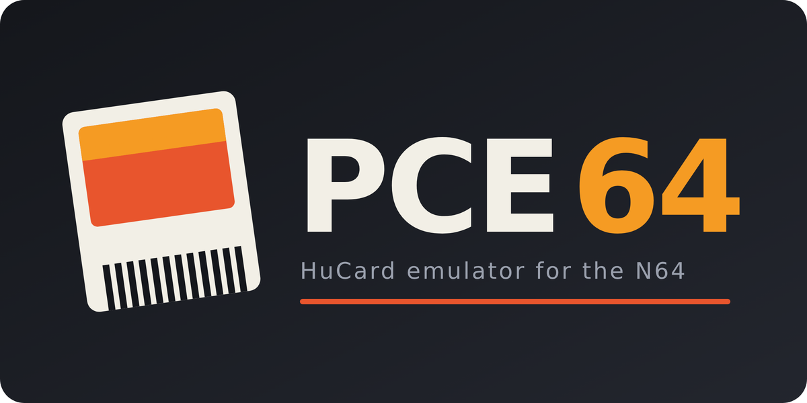

<p align="center"></p>

# PCE64: a PC Engine / TurboGrafx-16 emulator for the Nintendo 64

Version 0.1.

PCE64 runs PC Engine and TurboGrafx-16 HuCard games on a Nintendo 64: on real hardware with a flashcart (SummerCart64, EverDrive 64), on the Analogue 3D, or in an N64 emulator. CD-ROM² games are not supported yet.

**New in this version (0.1):**
- More exact timing of the video chip's interrupts, which fixes several games:
  - Air Zonk: no more flicker or missing background. The VDC's raster counter keeps counting through the vertical blank, and on the first vblank line the raster interrupt comes just before the vblank one, so the game carries its chain of mid-screen effects from frame to frame.
  - OutRun: the road no longer drops out for a frame. Video interrupts are taken at the exact instruction, as on the real CPU, so the game's interrupt on every line of the road is never late.
  - Cadash: the status bar no longer floats over the castle or flashes at the top of the screen.
  - TV Sports Football no longer stays on its title screen: the sprite table DMA raises its interrupt a few lines after the vblank one.
- The CPU sees a change to its interrupt state one instruction late, as the real one does: after CLI, and after a write that unmasks an interrupt. Jackie Chan's Action Kung Fu and New Adventure Island hung at a black screen without this.
- Populous: the 32 KB of RAM on its card is emulated.
- 768 KB HuCards (Darius Plus, Neutopia II, Raiden) are mapped as on the real card.
- Fixed a crash in games that use the widest background map (Salamander).
- The exact interrupt timing costs some speed in the heaviest games: After Burner II's take-off scenes and Street Fighter II' fights are a little slower than in the previous build (see Speed).
- From the previous updates:
  - the N64 waits for its graphics chip to finish a frame before changing what it draws from;
  - exact sprite-overflow interrupts;
  - sprite masking;
  - the picture placed as on a real PC Engine;
  - up to four players on a multitap;
  - backdrop gradients.

The emulator ships with no games. You add a HuCard image you own with the converter, which produces one ready-to-boot `.z64` per game.

## Download

Get `PCE64_v0.1.zip` from the [Releases](../../releases) page. It holds the template ROM (`PCE64_template.z64`), the converter page and script, and this README. No games are included: you supply HuCard images you own.

## Converting a game

**In a browser:** open `PCE64_converter.html`. Drop `PCE64_template.z64` in the first slot and your `.pce` file (or a `.zip` containing one) in the second, then click **Convert and save**. Everything runs locally, nothing is uploaded, and no internet connection is needed.

**From the command line** (Python 3, no extra packages):

```
python3 pce64_convert.py PCE64_template.z64 "Bonk's Adventure (USA).pce" Bonk.z64
```

Options:
- `--region us|jp|auto` sets the console the game sees. The default `auto` picks US for file names tagged `(USA)`, `(U)` or `(World)`, and Japan otherwise. A few games refuse to run on the wrong region.
- `--no-sprite-limit` draws every sprite on a line. That means less flicker, but it isn't what the hardware does.
- `--no-multitap` gives the game a single controller instead of a multitap. Only needed for a game that misbehaves when a multitap is plugged in. Youkai Douchuuki is the known case, and the converter sets this for it automatically.
- `--title "Name"` sets the title shown in flashcart menus.

The converter also:
- strips 512-byte copier headers;
- un-reverses bit-reversed US dumps;
- detects the Street Fighter II' mapper;
- refuses files that aren't HuCard images, SuperGrafx games, and ROMs that already contain a game.

## Controls

| N64 | PC Engine |
|---|---|
| D-pad or analog stick | Directions |
| A | Button I |
| B | Button II |
| C-right / C-down | Turbo I / turbo II (15 Hz) |
| Start | RUN |
| Z, L or R | SELECT |
| Start + Z + L + R | Reset |

Most games also have a soft reset of their own, RUN + SELECT.

N64 controllers 1 to 4 are PC Engine pads 1 to 4 on a multitap (TurboTap). A PC Engine has a single controller port, so every simultaneous two-player game, and games like Bomberman for up to four players here, needs this. Single-player games only read pad 1 and don't notice. The reset combination works on controller 1 only.

## Picture position

The picture sits on the screen where a real PC Engine puts it, to within a line or two. The game's whole 240-line frame is shown, and in 256-pixel modes it fills about 91% of the screen's width, as on the real console. On a CRT, overscan therefore trims the edges the way it trims a real PC Engine, which games were designed around. On a display that shows the whole signal, such as the Analogue 3D, you see the complete frame, including the edges a TV would hide.

## Requirements

- An N64 or compatible console with a way to run homebrew ROMs.
- Street Fighter II' Champion Edition (2.5 MB) needs the 8 MB Expansion Pak. Without it the ROM shows a message saying so. Every other HuCard fits in 4 MB.

## Status

Tested in depth (speed measured, every frame checked) with twenty-five games, all of which boot and play correctly:
- Aero Blasters, After Burner II, Air Zonk, Bloody Wolf, Bomberman '93, Bonk's Adventure, Bonk 3, Cadash, Chase H.Q., Darius Plus, Devil's Crush, Final Lap Twin, Fire Pro Wrestling 3 Legend Bout, Magical Chase, Moto Roader, Ninja Spirit, OutRun, Parodius Da!, Power Drift, Salamander, Soldier Blade, Splatterhouse, Street Fighter II' Champion Edition, Thunder Blade, Victory Run.

Also checked, by playing a scripted two minutes on the PC build of the same core: 1943 Kai, Alien Crush, Batman, Blazing Lazers, Bonk's Revenge, Darius Alpha, Dungeon Explorer, F1 Triple Battle, Galaga '90, Hit the Ice, Image Fight, Jackie Chan's Action Kung Fu, The Legendary Axe, Military Madness, Neutopia II, New Adventure Island, Ninja Ryuuken Den (Ninja Gaiden), The Ninja Warriors, Populous, Psychosis, R-Type, Raiden, Space Harrier, Super Star Soldier, TV Sports Football, Valkyrie no Densetsu.

That includes 256 KB, 384 KB, 768 KB and 1 MB ROM layouts, the widest background maps, mid-screen raster effects, line-by-line scrolling, sprite masking and the Street Fighter II mapper.

**Speed.** Every tested game runs at full speed, 60 frames per second, with no frame skipping, except for short stretches of After Burner II, Power Drift, Street Fighter II', Ninja Spirit, Victory Run and Air Zonk. These numbers come from the ares emulator, not real hardware. Each run is about two minutes of scripted play from power-on. A frame has 16.7 ms.

| Game | Average frame | Heaviest second | Frames shown late |
|---|---|---|---|
| Aero Blasters | 6.6 ms | 11.0 ms | 8 of 7,320 |
| After Burner II | 13.2 ms | 20.5 ms | 138 of 7,200 |
| Air Zonk | 10.6 ms | 17.0 ms | 13 of 7,320 |
| Bloody Wolf | 5.8 ms | 10.3 ms | 0 of 7,320 |
| Bomberman '93 | 6.5 ms | 11.1 ms | 7 of 7,320 |
| Bonk's Adventure | 6.8 ms | 9.8 ms | 2 of 7,320 |
| Bonk 3 | 9.1 ms | 13.5 ms | 3 of 7,380 |
| Cadash | 6.4 ms | 9.6 ms | 1 of 7,380 |
| Chase H.Q. | 7.4 ms | 11.0 ms | 3 of 7,380 |
| Darius Plus | 5.1 ms | 8.2 ms | 10 of 7,320 |
| Devil's Crush | 10.7 ms | 14.4 ms | 8 of 7,320 |
| Final Lap Twin | 13.5 ms | 16.7 ms | 23 of 7,320 |
| Fire Pro Wrestling 3 | 10.6 ms | 14.1 ms | 10 of 7,380 |
| Magical Chase | 9.9 ms | 15.6 ms | 33 of 7,320 |
| Moto Roader | 8.8 ms | 13.9 ms | 4 of 7,380 |
| Ninja Spirit | 10.9 ms | 17.3 ms | 22 of 7,320 |
| OutRun | 8.5 ms | 13.1 ms | 10 of 7,320 |
| Parodius Da! | 7.1 ms | 9.4 ms | 3 of 7,380 |
| Power Drift | 13.1 ms | 20.0 ms | 241 of 7,140 |
| Salamander | 6.9 ms | 9.6 ms | 3 of 7,380 |
| Soldier Blade | 9.1 ms | 14.2 ms | 8 of 5,100 |
| Splatterhouse | 9.7 ms | 13.0 ms | 12 of 7,260 |
| Street Fighter II' | 12.4 ms | 18.1 ms | 57 of 7,260 |
| Thunder Blade | 9.7 ms | 16.1 ms | 15 of 7,320 |
| Victory Run | 12.2 ms | 17.3 ms | 23 of 7,320 |

"Heaviest second" is the slowest 60-frame stretch, averaged. "Frames shown late" counts vertical blanks on which no new frame was ready. A single frame may run past 16.7 ms: the display is triple-buffered, so the emulator usually runs ahead and absorbs it.

Almost all late frames fall on scene changes, in hitches of a few frames at most:
- power-on;
- a stage loading while the screen is still on;
- a game rebuilding its whole background.

During play, the busiest games (Magical Chase, Street Fighter II' fights) show a late frame every few seconds at most, and the others far less often.

After Burner II and Power Drift are the most demanding games here. Both scale and rotate graphics in software, so the PC Engine's CPU is busy all frame. After Burner II's take-off scenes also change the scroll on every scanline. In their busiest moments these two run at about 80 to 85% speed for a few seconds (After Burner II's take-offs are the worst case); the rest of the time they keep full speed apart from an occasional late frame. Street Fighter II' dips to about 90% for a second or so when a fight starts and in its busiest exchanges. Ninja Spirit, Victory Run and Air Zonk dip briefly in their busiest scenes. Thunder Blade's behind-the-helicopter 3D sections take about 14 ms a frame, and the switch into them about 17 ms for a second. Final Lap Twin and Victory Run take a raster interrupt every two or three lines all race long; they hold full speed with a late frame every several seconds at most.

**Known limitations:**
- Short hitches at some scene changes. After Burner II and Power Drift slow down in their busiest moments, and Street Fighter II', Ninja Spirit, Victory Run and Air Zonk dip briefly (see above).
- CD-ROM² and SuperGrafx games aren't supported.
- No save support. HuCards themselves don't save; the Tennokoe backup units are not emulated.
- Mid-frame changes to palette colours take effect for the whole frame (the palette at the end of the visible frame is used). The exception is the backdrop colour, which games change between lines for sky and floor gradients. It is shown line by line.

## How it works

- **CPU.** A HuC6280 recompiler translates 6280 code into MIPS for the N64's VR4300. An interpreter in C covers what the recompiler doesn't translate. The recompiler checks interrupts and the cycle budget at exactly the same points as the interpreter. When the next event is a video interrupt, both stop at the exact instruction it falls on: a block of translated code that would run past it switches to a twin translated with a check after every instruction, and after the interrupt the game goes on in the middle of the original block. Timer interrupts, which games use for sound, are taken at the next jump or branch, which keeps the recompiled code fast.
  - Code is translated once it has run a few times. Code in RAM is checked on entry and translated again when a game rewrites it.
  - The most frequent hardware accesses run in a small hand-written runtime that never leaves the instruction cache: VDC registers and VRAM writes, palette writes, sound registers, timer interrupts.
  - Translated code is laid out around the part of the instruction cache that the emulator's own per-line code uses, and its rarely run parts fill the addresses that share cache lines with that code.
  - Long block transfers (big VRAM uploads) spread over several frames, as they do on the real machine.
  - Verification: instruction-by-instruction lockstep against a reference core; millions of random instructions; frame-by-frame state comparison between recompiler and interpreter; per-frame state hashes compared with the PC build.
- **Wait loops.** Idle loops (a game spinning on a RAM flag until an interrupt) are detected and fast-forwarded.
- **Video.** The core doesn't draw pixels. For each frame it records what the screen shows:
  - bands of background lines;
  - sprite strips;
  - an image of the whole background map;
  - a cache of sprite patterns.

  The N64's RDP draws the frame from those, with palette lookup tables. Lines whose video memory changes after they were shown are drawn by the CPU instead, so mid-frame effects still come out right. Output is checked to be identical, frame by frame, to a line-by-line software renderer.
- **Sound.** The PSG (six wavetable channels, DDA and noise) is synthesized once per frame from a log of register writes. Sample playback through DDA is mixed inside that pass. The output is bit-identical to per-scanline generation.

## Building from source

- **Core** (`core/`): portable C. On a PC it builds the test harness (`host/`): `gcc -O2 -Icore -o pce_host core/cpu.c core/cpu_step.c core/cpu_ramrun.c core/pce.c core/vdc.c core/psg.c host/main.c -lm`.
- **N64 frontend** (`n64/`): uses libdragon (trunk, commit `e356bf3f`).
  - Run `make` in `n64/` with `N64_INST` set. `PCE_JIT=0` builds without the recompiler.
  - The speed figures need libdragon built as a release library (`-DNDEBUG`). Its debug asserts cost several milliseconds a frame. Point `PCE_LIBDIR` at a folder holding the release `libdragon.a` and `libdragonsys.a`.
  - `n64/pce64.ld` is libdragon's linker script with one change: the emulator's per-event code goes first, in one piece, with its per-line part at the very start.
- **Tools:**
  - `tools/gen_cputab.py` and `tools/gen_cpuops.py` generate the CPU tables and handlers.
  - `tools/pce64_convert.py` is the converter.
  - The ares test scripts expect a headless ares build and have paths to adjust:
    - `tools/n64run.sh` runs a game with stats;
    - `tools/n64speed2.sh` with `busy.awk` measures speed;
    - `tools/n64verify.sh` runs recompiler and interpreter side by side;
    - `tools/n64fuzz.sh` runs the random-code test.

## Licence

Copyright (C) 2026 FlandersMega92.

PCE64 is free software: you can redistribute it and/or modify it under the terms of the GNU General Public License as published by the Free Software Foundation, either version 3 of the License, or (at your option) any later version. It is distributed in the hope that it will be useful, but WITHOUT ANY WARRANTY. See [LICENSE](LICENSE).

The N64 build links against [libdragon](https://github.com/DragonMinded/libdragon), which is released under the Unlicense.

PC Engine and TurboGrafx-16 are trademarks of their owners, as are Nintendo 64 and Analogue 3D. This project is not affiliated with or endorsed by any of them.
